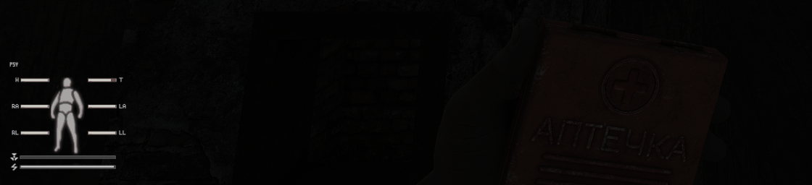

# Unholy's Direct Limb Healing Mod

Heal injured limbs directly with first-aid kits. Grok's Body Health System still tracks each limb, and the normal item-use animations play when you treat an injury. Medkits, stimpacks, Rebirth and survival kits restore permanent limb HP. Romeo's AFAK also uses the standard medkit values for each charge.

*Torso injured before using a medkit.*

*The torso recovers when the medkit takes effect.*
