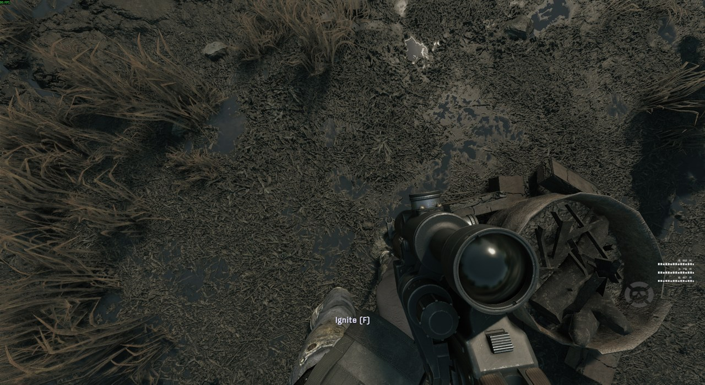

# Unholy's Direct Limb Healing Mod

Heal injured limbs directly with first-aid kits. Grok's Body Health System still tracks each limb, and the normal item-use animations play when you treat an injury. Medkits, stimpacks, Rebirth and survival kits restore permanent limb HP. Romeo's AFAK also uses the standard medkit values for each charge.



The Romeo playtest restored 3.85 torso HP with 0.00 temporary HP. The screenshot shows the campfire from that test session.

## Compatibility

| Game | Requirements and verification |
| --- | --- |
| Anomaly 1.5.3 | Stock Anomaly already heals directly. For limb-based healing, install [Grok's Body Health System Redux 2.0.2](https://www.moddb.com/mods/stalker-anomaly/addons/100-groks-body-health-system-redux-for-151) and build an overlay. The generated overlay passed LuaJIT and healing checks. |
| GAMMA | Uses the Body Health System script from your active MO2 profile. The overlay built successfully against the GAMMA profile and passed LuaJIT and healing checks. |
| Romeo | Uses the active Romeo MO2 profile, including an xrRazom co-op revive adapter. The original Romeo patch passed an in-game healing test. The generated overlay also passed LuaJIT, healing and revive callback checks. |

Use this mod or Unholy's Field Medical Mod for a given profile. Both handle limb injuries and first-aid item use.

## Install

Download the [patch builder](https://github.com/noahcabral/unholys-direct-limb-healing-mod/releases/latest) and extract it. The builder uses Python 3 and creates a ZIP from the Body Health System files already installed on your computer.

For GAMMA or Romeo, point the builder at the MO2 base directory, the separate Anomaly game folder and your profile. Use the exact profile name shown in MO2. Run this from the folder containing `patch.py`.

```powershell
python patch.py --mo2 "D:\Games\GAMMA" --game "D:\Games\Anomaly" --profile "G.A.M.M.A" --output "Direct Limb Healing.zip"
```

For a standalone Anomaly installation with Body Health System in the game's `gamedata` directory, use the game folder as your donor.

```powershell
python patch.py --donor "D:\Games\Anomaly" --output "Direct Limb Healing.zip"
```

Install the generated ZIP with the archive installer in Mod Organizer 2. Enable it at a higher priority than Body Health System, the pack's medical or text patches, and xrRazom in Romeo. Disable earlier Direct Limb Healing overlays. If an earlier overlay has a custom name, pass that name with `--skip-mod` when building. Use a new output filename for subsequent builds.

For a loose-file installation, save a copy of each file listed by the builder, then merge the generated `gamedata` into the game folder. To uninstall, disable the mod in MO2 or restore those files.

If the builder reports an unsupported donor, keep your current files and check which mod provides `gamedata/scripts/zzz_player_injuries.script`. The builder checks that the supported healing handlers are present before writing a ZIP. Tooltip wording changes currently cover English.

## Credits

Built on Grokitach's Body Health System Redux and the original Body Health System by Favkis_Nexerade. Pack-specific changes come from your installed GAMMA or Romeo profile. [Body Health System Redux](https://www.moddb.com/mods/stalker-anomaly/addons/100-groks-body-health-system-redux-for-151)
